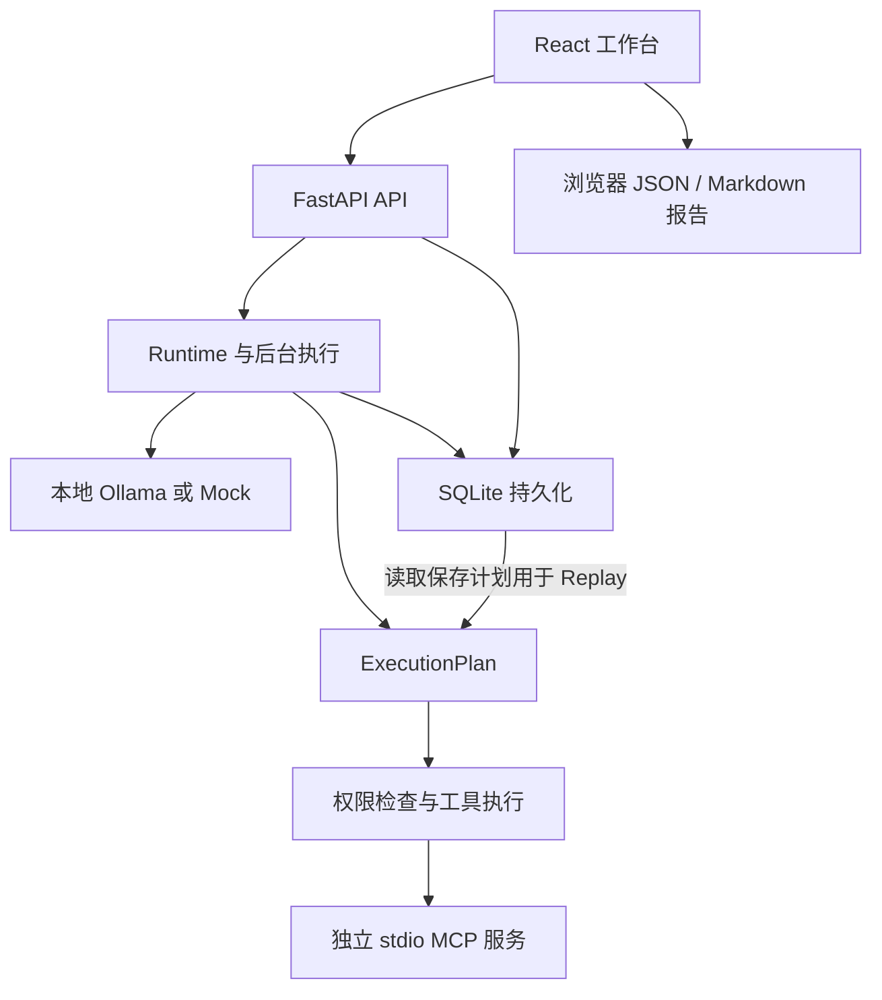

# AgentDesk 架构与设计取舍

AgentDesk 是 FastAPI、React/TypeScript/Vite、SQLAlchemy/SQLite 和本地 Ollama
组成的 Agent 工作台。Mock 是可选的确定性演示模式。目标是让本地 Agent 的执行、
失败、重放和记忆使用过程可检查、可保存，而非构建公网多租户托管平台。

## 主要关系

报告由浏览器已经读取的数据生成。图中的 SQLite 关系包括读取、记录状态、Trace、
Snapshot 和记忆捕获；并不是每个 API 都会写入数据库。MCP 业务工具使用自己的
依赖环境，订单/物流返回演示夹具，工单使用独立本地 SQLite 存储。

| 层 | 当前主要代码 | 职责 |
| --- | --- | --- |
| 工作台 | frontend/src/pages/HomePage.tsx、frontend/src/components/ | Agent 选择、任务/会话、历史、Inspector、记忆和导出 |
| API | backend/app/api/、backend/app/schemas/ | 输入校验、资源范围、HTTP 错误与读取合同 |
| 执行 | backend/app/workers/execution_worker.py、backend/app/runtime/ | 规划适配、步骤执行、工具权限、结果和失败持久化 |
| 执行证据 | backend/app/services/execution_trace.py、execution_snapshot.py | 结构化事件、版本化 Snapshot、保存计划 Replay |
| 记忆 | backend/app/services/memory_retrieval.py、semantic_memory.py、memory_vector_cache.py、memory_evidence.py | 作用域检索、语义排序、缓存与历史捕获 |
| 存储 | backend/app/models/、backend/app/database.py、backend/alembic/ | SQLite/SQLAlchemy 模型与已有迁移 |
| MCP | mcp-server/、backend/app/tools/ | 本地 stdio 协议、工具适配与独立依赖环境 |
| 验证 | backend/tests/、frontend/tests/、evaluation/、.github/workflows/ci.yml | 单元/集成检查、固定数据集与 CI |

表中代码路径以仓库根目录为起点。前端开发时使用 Vite 代理；容器部署由 Nginx
提供构建后的静态文件并代理 API，见 frontend/vite.config.ts 和 frontend/nginx.conf。
默认 Compose 将主服务端口绑定在本机回环地址，并将数据库持久化在命名卷中。

## 一次执行如何留下证据

1. 用户提交任务，API 创建 execution，再由现有后台执行入口处理。
2. Planner 的任务信息适配成 ExecutionPlan，保留结构化工具参数。
3. 执行器顺序执行步骤。后续步骤可通过 `$step_output` 引用已完成步骤的输出。
4. 工具执行按 Agent 的 allowed_tools 检查权限，并区分不存在的工具、参数错误、
   权限拒绝和工具运行失败。
5. Runtime 保存执行结果/失败元数据、结构化 Trace 和版本化 Snapshot。
6. Inspector 通过现有读取接口显示这些记录；可以生成带导出时间的报告。

具体入口见 [backend 文档](../backend/README.md) 与 Runtime 代码。规划器的输出
仍可能失败；有结构化计划不等于任意任务都会正确执行。

## 三个容易混淆的概念

| 概念 | 保存什么/做什么 | 不保证什么 |
| --- | --- | --- |
| Trace | 执行时的计划/步骤事件和消息 | 不替代完整分布式追踪或生产审计系统 |
| Snapshot | 版本化的输入、计划、输出 | 不是数据库备份，也不保存全部外部环境 |
| Replay | 验证保存计划后创建新执行，按当前工具权限重新执行 | 不保证外部工具返回同样数据；写操作可能再发生 |

Replay 不重新调用 Planner，但实际会重新执行工具。无效或不兼容的 Snapshot
在创建重放执行之前校验。失败会按现有流程保存并返回相应 API 错误。

## 记忆检索与历史依据

Agent 记忆和共享用户记忆按范围读取。关键词模式提供匹配词与分数；语义模式
使用本地向量及余弦相似度。SQLite 向量缓存复用已有嵌入，并覆盖编辑、删除和
范围变化的缓存检查。发生语义检索回退时，保存实际使用的模式与回退原因。

Runtime 构造记忆上下文时保存捕获记录。Inspector 的 Show memory retrieval 读取
该执行的历史证据；后来编辑当前记忆不会把原执行的输入上下文换成新内容。

报告 schema version 2 可包含已显式加载的捕获；未加载、加载中、未记录、已加载、
读取失败是不同状态。导出重新校验执行、Agent、输入和记忆范围，不额外访问 API。
详见 [报告合同](execution-report-memory-evidence.md)。

本项目的语义记忆检索不是文档摄取/切分/知识库索引的完整 RAG 产品。
固定 Mock 向量是测试夹具；真实 Ollama 的质量需要按实际模型和数据集测量。

## 为什么这样设计

| 选择 | 原因 | 代价/边界 |
| --- | --- | --- |
| 本地 Ollama + 显式 Mock | 不依赖付费 LLM API，演示与测试可确定运行 | 真实效果受本机资源、模型和任务影响；Mock 不评价模型能力 |
| SQLite + 命名数据卷 | 本地部署简单，服务重新创建后仍保留记录 | 没有证明多节点部署和高并发性能 |
| ExecutionPlan + Snapshot | 将规划、工具参数和重放输入变成可检查的数据 | Replay 使用当前工具环境，不是环境级可复现性 |
| 结构化 Trace + 捕获记忆 | 解释执行步骤和当时使用的记忆 | 多个读取接口不是原子事务快照 |
| MCP 独立依赖环境 | 保留协议边界，隔离后端与 MCP 依赖 | 远程服务器管理、连接池属于后续工作 |
| 浏览器本地报告 | 导出无需新接口或数据库写入 | 10 MiB 限制；包含用户文本，分享前需检查 |

## 验证与边界

CI 配置包含结构、后端/前端测试、前端构建、Compose Mock、MCP 与持久化检查。
固定评估数据集有八个 Runtime 用例，覆盖输出、工具、Trace、Snapshot 和 Replay。
CI 工作流存在不代表某次运行已经通过；应查看对应提交的 Checks。

903 项前端测试是 2026-10-12、Issue #163 实现时的本地验证记录，不是永久不变的
项目指标。有关最新测试结果，使用对应代码版本的实际输出。

当前后台执行使用应用内后台任务，并未替换成持久化分布式任务队列。
Agent 工具权限和资源作用域不等同于公网认证或完整安全隔离。公开生产部署前，
仍需单独处理认证、授权、部署运维及负载验证。本文不作生产就绪或吞吐保证。
